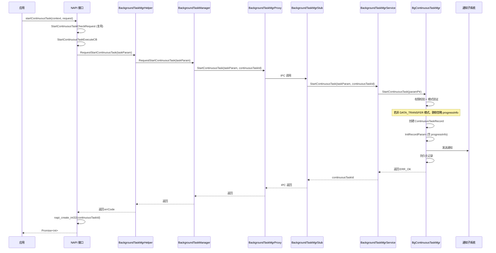
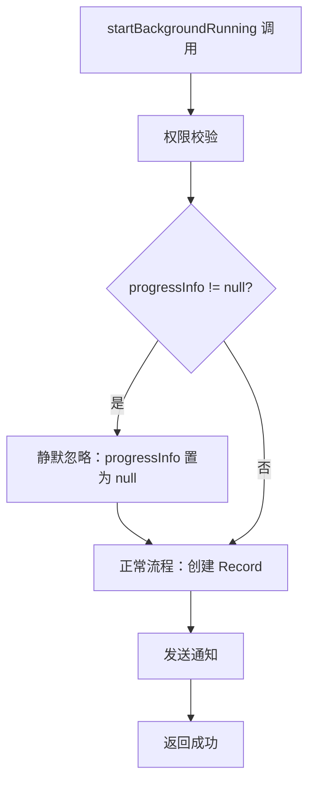
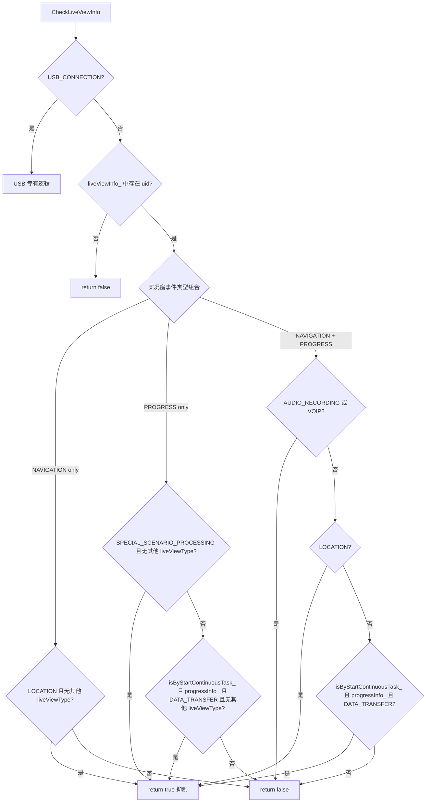
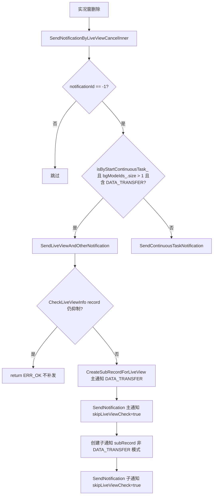

# Design 增量设计

> 本文档描述对长时任务代码设计的增量变更。
> 基础设计参考：`docs/design/continuous_task.md`、`docs/design/overview.md`

---

## 1. 设计背景

### 1.1 设计目标

新增 `startContinuousTask` NAPI 接口，功能与 `startBackgroundRunning(context, request: ContinuousTaskRequest)` 完全一致，仅返回值不同（返回 `continuousTaskId`（`int`）而非 `ContinuousTaskNotification`）。同时将 `ContinuousTaskRequest.progressInfo` 字段的使用限定在 `startContinuousTask` 接口（且仅 `DATA_TRANSFER` 模式生效），`startBackgroundRunning` 中传入 `progressInfo` 静默忽略（不生效，不报错）。

### 1.2 设计约束

1. `ContinuousTaskRequest`、`ProgressInfo`、`DataTransferProgress` 结构体已存在，不修改结构体定义
2. `ERR_BGTASK_CONTINUOUS_PROGRESS_INFO_INVALID` 错误码已存在于 `bgtaskmgr_inner_errors.h:95`
3. 停止/更新操作复用现有 `stopBackgroundRunning` / `updateBackgroundRunning`，不新增对应接口
4. 不需要 API 版本拦截（接口在 API26 声明，编译时已保证）
5. 遵循现有三层架构：NAPI → frameworks → services
6. 遵循现有 IPC 模式：IDL 声明 → Proxy 调用 → Stub 分发 → 子模块实现

### 1.3 非目标

- 不修改 `ContinuousTaskNotification` 结构体
- 不新增 `ContinuousTaskIdInfo` 结构体（返回值直接使用 `int` 类型的 `continuousTaskId`）
- 不新增 `stopContinuousTask` / `updateContinuousTask` 接口
- 不修改 `ContinuousTaskRecord` 结构体（已有 `progressInfo_` 字段）
- 不修改通知逻辑

---

## 2. 设计决策

### 2.1 IPC 接口设计

**决策**：在 `IBackgroundTaskMgr.idl` 中新增 `StartContinuousTask` 方法，复用 `ContinuousTaskParam` 入参，通过 `[out] int continuousTaskId` 返回任务 ID。

**背景**：`startContinuousTask` 与 `startBackgroundRunning` 功能一致，仅返回值不同。可以复用现有的 `ContinuousTaskParam` 入参和 `StartBackgroundRunningInner` 核心逻辑。

**方案对比**：

| 方案 | 优点 | 缺点 |
|------|------|------|
| 方案A（采纳）：新增独立 IPC 方法 `StartContinuousTask` | 接口职责清晰，服务端可区分调用来源进行 progressInfo 处理 | 新增 IPC 方法，需维护两条调用路径 |
| 方案B：复用 `StartBackgroundRunning`，在 NAPI 层裁剪返回值 | 无需新增 IPC 方法 | 无法在服务端区分接口来源，无法实现 progressInfo 处理 |
| 方案C：在 `ContinuousTaskParam` 中新增标记位区分 | 改动小 | 侵入现有结构体，语义不清 |

**理由**：
- 服务端需要区分调用来源以执行 progressInfo 处理逻辑
- 新增 IPC 方法符合现有架构风格（IDL 声明 → Proxy → Stub → 子模块）
- `ContinuousTaskParam` 已有 `isByRequestObject_` 等标记位，再加标记位会导致语义混乱

### 2.2 progressInfo 处理位置

**决策**：
1. 在 `BgContinuousTaskMgr::StartBackgroundRunning` 方法入口处检查 `progressInfo`，非 null 时静默忽略（置为 null），接口正常调用。
2. 在 `BgContinuousTaskMgr::StartContinuousTask` 方法中检查 `progressInfo`，若非 null 且任务不包含 `DATA_TRANSFER` 后台模式，静默忽略（置为 null）。
3. 在 `StartContinuousTaskInner` 中再次检查 record 的 `progressInfo`，若无 `DATA_TRANSFER` 模式则静默忽略（置为 null）。

**背景**：`StartBackgroundRunningByRequestExecuteCB`（NAPI 层）已将 `request->GetProgressInfo()` 赋值给 `taskParam.progressInfo_`，因此处理必须在服务端 `BgContinuousTaskMgr` 层执行。

**理由**：
- 服务端是业务规则的唯一权威来源
- 静默忽略而非报错，保证接口兼容性，现有应用传入 progressInfo 不会中断
- `DATA_TRANSFER` 是唯一支持 progressInfo 的后台模式，非该模式时 progressInfo 无意义

### 2.3 NAPI 接口实现

**决策**：在 NAPI 层新增 `StartContinuousTask` 函数，复用 `StartBackgroundRunningCheckRequest` 参数解析逻辑，新增 `StartContinuousTaskExecuteCB` 执行回调，返回 `int` 类型的 `continuousTaskId`。

**理由**：
- 参数解析逻辑与 `startBackgroundRunning(request)` 完全一致，可复用 `StartBackgroundRunningCheckRequest`
- 执行回调需区分：调用新的 `RequestStartContinuousTask` helper 方法
- 返回值构造不同：只返回 `continuousTaskId`（`int`），不返回 `notificationId`/`slotType`/`contentType`

---

## 3. 数据模型变更

### 3.1 新增结构体

无。`startContinuousTask` 返回值直接使用 `int` 类型的 `continuousTaskId`，不需要新增结构体。

### 3.2 修改结构体

无。`ContinuousTaskRequest`、`ContinuousTaskParam`、`ContinuousTaskRecord` 均已有 `progressInfo_` 字段，无需修改。

---

## 4. 接口设计变更

### 4.1 新增 IDL 接口

**文件**：`interfaces/innerkits/IBackgroundTaskMgr.idl`

```idl
void StartContinuousTask([in] ContinuousTaskParam taskParam, [out] int continuousTaskId);
```

**说明**：
- 入参与 `StartBackgroundRunning` 完全一致（`ContinuousTaskParam`）
- 输出参数仅 `continuousTaskId`，不输出 `notificationId`
- Stub 端生成 `BackgroundTaskMgrStub::StartContinuousTaskRemoteRequest` 处理函数

### 4.2 新增客户端代理方法

**文件**：`frameworks/include/background_task_manager.h` + `frameworks/src/background_task_manager.cpp`

```cpp
ErrCode RequestStartContinuousTask(ContinuousTaskParam &taskParam);
```

**实现逻辑**：
1. 获取 proxy
2. 调用 `proxy_->StartContinuousTask(*taskParamPtr, continuousTaskId)`
3. 回写 `taskParam.continuousTaskId_`
4. 不回写 `notificationId_`

### 4.3 新增 Helper 方法

**文件**：`interfaces/innerkits/include/background_task_mgr_helper.h` + `interfaces/innerkits/src/background_task_mgr_helper.cpp`

```cpp
static ErrCode RequestStartContinuousTask(ContinuousTaskParam &taskParam);
```

### 4.4 新增服务端方法

**文件**：`services/core/include/background_task_mgr_service.h` + `services/core/src/background_task_mgr_service.cpp`

```cpp
ErrCode StartContinuousTask(const ContinuousTaskParam &taskParam, int32_t& continuousTaskId);
```

**实现逻辑**：
1. Atomic Service 校验（同 `StartBackgroundRunning`）
2. 调用 `BgContinuousTaskMgr::GetInstance()->StartContinuousTask(paramPtr)`
3. 回写 `continuousTaskId`

### 4.5 新增子模块方法

**文件**：`services/continuous_task/include/bg_continuous_task_mgr.h` + `services/continuous_task/src/bg_continuous_task_mgr.cpp`

```cpp
ErrCode StartContinuousTask(const sptr<ContinuousTaskParam> &taskParam);
```

**实现逻辑**：
1. 复用 `StartBackgroundRunning` 的全部校验和创建逻辑
2. 不设置 `taskParam->notificationId_`（NAPI 层不需要）
3. 设置 `taskParam->continuousTaskId_`
4. 若 `progressInfo` 非 null 但任务不包含 `DATA_TRANSFER` 模式，静默忽略（置为 null），接口正常调用

### 4.6 修改现有接口

**文件**：`services/continuous_task/src/bg_continuous_task_mgr.cpp`

**修改方法**：`StartBackgroundRunning`（第 1007 行）

**修改内容**：在 `CheckTaskParam` 之后、`StartBackgroundRunningInner` 之前，新增 progressInfo 静默忽略逻辑：

```cpp
if (taskParam->progressInfo_ != nullptr) {
    BGTASK_LOGI("progressInfo is not effective in startBackgroundRunning, ignore it");
    taskParam->progressInfo_ = nullptr;
}
```

### 4.7 新增 NAPI 接口

**文件**：`interfaces/kits/napi/src/bg_continuous_task_napi_module.cpp` + `interfaces/kits/napi/include/common.h`

**新增函数**：

| 函数名 | 说明 |
|--------|------|
| `StartContinuousTask(napi_env, napi_callback_info, bool isThrow)` | NAPI 入口，解析参数并提交异步任务 |
| `StartContinuousTaskThrow(napi_env, napi_callback_info)` | 抛异常版本入口 |
| `StartContinuousTaskExecuteCB(napi_env, void *data)` | 异步执行回调，调用 `RequestStartContinuousTask` |
| `StartContinuousTaskPromise(napi_env, AsyncCallbackInfo*, bool)` | 创建 Promise |
| `StartContinuousTaskPromiseCompletedCB(napi_env, napi_status, void *data)` | Promise 完成回调，`napi_create_int32` 返回 `continuousTaskId` |

**NAPI 注册**：

**文件**：`interfaces/kits/napi/src/init_bgtaskmgr.cpp`

```cpp
DECLARE_NAPI_FUNCTION("startContinuousTask", StartContinuousTaskThrow),
```

### 4.8 新增 Taihe IDL 声明

**文件**：`interfaces/kits/ets/taihe/idl/ohos.resourceschedule.backgroundTaskManager.taihe`

```taihe
@rename("startContinuousTask")
@promise function StartContinuousTask(
  context: @sts_type("BaseContext") Opaque, request: ContinuousTaskRequest): i32;
```

---

## 5. 流程设计

### 5.1 startContinuousTask 调用时序



### 5.2 startBackgroundRunning progressInfo 处理流程



### 5.3 通知抑制与实况窗互斥流程

`CheckLiveViewInfo` 方法重构为三分支结构，根据实况窗事件类型组合（NAVIGATION / PROGRESS / Both）分别处理：



**新增字段 `isByStartContinuousTask_`**：
- 文件：`services/continuous_task/include/continuous_task_record.h`
- 类型：`bool`，默认 `false`
- 设置位置：`StartContinuousTask` 方法创建 record 时设为 `true`；`CreateSubRecordForLiveView` 创建主通知 subRecord 时设为 `true`
- 持久化：`ParseToJsonStr` / `ParseFromJson` / `SetRecordValue` / `CheckContinuousRecod` 均已适配
- 作用：在 `CheckLiveViewInfo` 的 PROGRESS 分支和 NAVIGATION+PROGRESS 分支中，控制 DATA_TRANSFER 模式的抑制路径

### 5.4 实况窗删除后通知补发流程



**关键设计决策**：

1. **`CheckNotificationText` 新增 `skipLiveViewCheck` 参数**：
   - 文件：`services/continuous_task/include/bg_continuous_task_mgr.h` + `services/continuous_task/src/bg_continuous_task_mgr.cpp`
   - 默认 `false`，保持现有调用点行为不变
   - `SendNotification`（由 `SendLiveViewAndOtherNotification` 调用）传 `true`
   - 原因：`SendLiveViewAndOtherNotification` 顶层已通过 `CheckLiveViewInfo(record)` 对完整 record 做抑制判断。拆分发送时 subRecord 模式列表与原始 record 不同（主通知=[DATA_TRANSFER]，子通知=[LOCATION]），`CheckExistOtherMode` 结果不一致会导致子通知被误抑制

2. **`SendLiveViewAndOtherNotification` 顶层增加 `CheckLiveViewInfo` 守卫**：
   - 在发送主/子通知前，先对完整 record 调用 `CheckLiveViewInfo`
   - 若仍被抑制（如实况窗部分删除但仍有其他实况窗覆盖），则不补发通知

3. **`CancelBgTaskNotificationInner` 增加子通知取消**：
   - 实况窗生效取消主通知时，若 `subNotificationId_ != -1` 且 `isByStartContinuousTask_=true`，同时取消子通知
   - 确保实况窗抑制状态下主/子通知状态一致

---

## 6. 风险与缓解

| 风险 | 可能性 | 影响 | 缓解措施 |
|------|--------|------|----------|
| `startBackgroundRunning` 新增 progressInfo 静默忽略处理 | 低 | 低 | progressInfo 非空时静默置 null，接口正常返回，不影响现有应用 |
| NAPI 层复用 `StartBackgroundRunningCheckRequest` 可能遗漏差异 | 低 | 中 | 参数解析逻辑完全一致，仅在执行回调和返回值构造上区分 |
| IPC 新增方法导致 Stub 码值冲突 | 低 | 高 | IDL 编译自动分配码值，遵循现有生成规则 |
| `CheckLiveViewInfo` 三分支重构影响现有抑制逻辑 | 中 | 中 | NAVIGATION-only 和 PROGRESS-only 分支保持原有条件不变，新增条件仅在 `isByStartContinuousTask_=true` 时生效 |
| `skipLiveViewCheck=true` 导致非抑制通知误发 | 低 | 中 | 仅在 `SendLiveViewAndOtherNotification` 顶层 `CheckLiveViewInfo` 通过后使用，不绕过顶层抑制判断 |
| `isByStartContinuousTask_` 持久化兼容性 | 低 | 低 | JSON 序列化新增字段，旧版本反序列化时 `CheckContinuousRecod` 校验失败会跳过该 record（需确认兼容性） |

---

## 7. 待解决问题

- [ ] `StartContinuousTask` 的 Stub 码值由 IDL 编译自动分配，需确认不与现有码值冲突

---

## 合并检查清单

- [ ] 接口设计变更（IDL / Proxy / Stub / Service / 子模块 / NAPI / Taihe）已添加到设计文档
- [ ] 流程设计（startContinuousTask 时序图、progressInfo 校验流程图）已添加
- [ ] 风险评估已完成
- [ ] 修改文件清单完整
