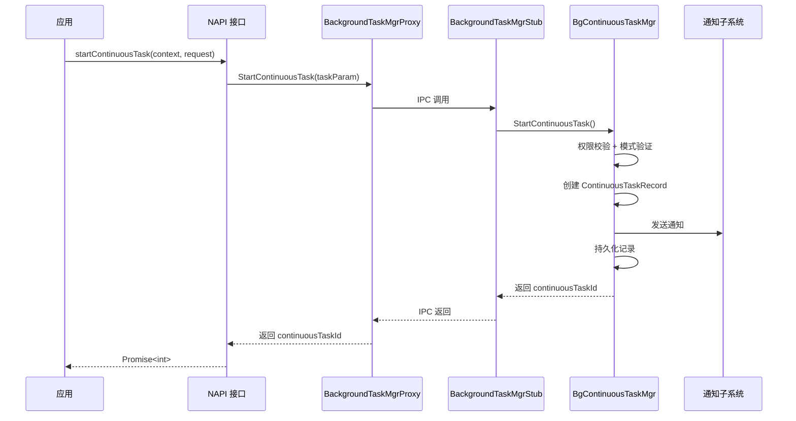

# Spec 增量设计

> 本文档描述对长时任务规格的增量变更，使用 ADDED/MODIFIED/REMOVED 标记。
> 基础规格参考：`docs/spec/continuous_task.md`

---

## ADDED Requirements

### 5.1 startContinuousTask 接口

#### 5.1.1 业务规则

1. **接口声明**：新增 `startContinuousTask(context: Context, request: ContinuousTaskRequest): Promise<int>` 接口，从 API26 开始提供。
   - **验收条件**：应用调用 `startContinuousTask` → 返回 `Promise<int>`，返回值为有效的 `continuousTaskId`
   - **验收条件**：`startContinuousTask` 的功能行为（权限校验、模式验证、通知发送、订阅者通知、持久化、互斥检查）必须与 `startBackgroundRunning` 完全一致

2. **返回值规则**：`startContinuousTask` 返回 `int` 类型的 `continuousTaskId`，不返回 `notificationId`、`slotType`、`contentType`。
   - **验收条件**：调用成功 → `continuousTaskId` 为有效正整数
   - **验收条件**：调用失败 → Promise reject，携带对应错误码

3. **progressInfo 字段生效规则**：`ContinuousTaskRequest.progressInfo` 字段仅在 `startContinuousTask` 接口中合法生效。在 `startContinuousTask` 中，仅当任务包含 `DATA_TRANSFER` 后台模式时 progressInfo 生效；若任务不包含 `DATA_TRANSFER` 模式但传入了 progressInfo，接口正常调用，progressInfo 字段不生效（静默忽略）。
   - **验收条件**：通过 `startContinuousTask` 传入 `progressInfo` 且任务包含 `DATA_TRANSFER` 模式 → 正常处理，进度信息生效
   - **验收条件**：通过 `startContinuousTask` 传入 `progressInfo` 且任务不包含 `DATA_TRANSFER` 模式 → 正常处理，progressInfo 字段不生效（静默忽略）
   - **验收条件**：通过 `startContinuousTask` 不传入 `progressInfo`（字段为 null） → 正常处理，不影响任务申请

4. **停止与更新规则**：通过 `startContinuousTask` 申请的长时任务，停止操作复用 `stopBackgroundRunning`，更新操作复用 `updateBackgroundRunning`。
   - **验收条件**：`startContinuousTask` 申请的任务可通过 `stopBackgroundRunning` 正常停止
   - **验收条件**：`startContinuousTask` 申请的任务可通过 `updateBackgroundRunning` 正常更新

#### 5.1.2 交互流程

#### 5.1.3 异常场景

1. **场景：progressInfo 在 startBackgroundRunning 中传入**
   - **触发条件**：应用调用 `startBackgroundRunning` 时 `ContinuousTaskRequest.progressInfo` 不为 null
   - **系统行为**：接口正常调用，progressInfo 字段不生效（静默忽略，置为 null）
   - **用户感知**：接口正常返回，progressInfo 不影响任务申请

2. **场景：服务未就绪**
   - **触发条件**：`startContinuousTask` 调用时服务未就绪（`isReady_=false`）
   - **系统行为**：拒绝请求，返回 `ERR_BGTASK_SYS_NOT_READY` 错误码
   - **用户感知**：Promise reject，错误码 `ERR_BGTASK_SYS_NOT_READY`

3. **场景：权限校验失败**
   - **触发条件**：应用未声明 `ohos.permission.KEEP_BACKGROUND_RUNNING` 权限
   - **系统行为**：拒绝请求，返回权限错误码
   - **用户感知**：Promise reject，权限错误码

#### 5.1.4 通知抑制与实况窗互斥规则（API26 新增）

`startContinuousTask` 申请的长时任务在通知发送时，与实况窗（LiveView）存在互斥抑制关系。`CheckLiveViewInfo` 方法根据实况窗事件类型和任务后台模式组合判断是否抑制通知：

| 实况窗事件 | 任务模式 | 抑制条件 | 抑制结果 |
|-----------|---------|---------|---------|
| NAVIGATION only | LOCATION 且无其它 liveViewType | 满足 | 抑制通知 |
| PROGRESS only | SPECIAL_SCENARIO_PROCESSING 且无其它 liveViewType | 满足 | 抑制通知 |
| PROGRESS only | DATA_TRANSFER 且 `isByStartContinuousTask_=true` 且 `progressInfo_!=nullptr` 且无其它 liveViewType | 满足 | 抑制通知 |
| NAVIGATION + PROGRESS | LOCATION（无 AUDIO_RECORDING/VOIP） | 满足 | 抑制通知 |
| NAVIGATION + PROGRESS | DATA_TRANSFER 且 `isByStartContinuousTask_=true` 且 `progressInfo_!=nullptr` | 满足 | 抑制通知 |
| NAVIGATION + PROGRESS | AUDIO_RECORDING 或 VOIP | 不抑制 | 发送通知 |

> **`isByStartContinuousTask_` 标记**：通过 `startContinuousTask` 接口申请的任务自动设置 `isByStartContinuousTask_=true`，用于区分调用来源。该标记在 `CheckLiveViewInfo` 中控制 DATA_TRANSFER + PROGRESS 实况窗的抑制路径，仅 `startContinuousTask` 申请且携带 `progressInfo` 的 DATA_TRANSFER 任务才会被 PROGRESS 实况窗抑制。

- **验收条件**：通过 `startContinuousTask` 申请 DATA_TRANSFER 模式且传入 progressInfo，发送 PROGRESS 实况窗 → 通知被抑制（不发送标准通知）
- **验收条件**：通过 `startContinuousTask` 申请 DATA_TRANSFER 模式但未传入 progressInfo，发送 PROGRESS 实况窗 → 通知不抑制（正常发送）
- **验收条件**：通过 `startBackgroundRunning` 申请 DATA_TRANSFER 模式，发送 PROGRESS 实况窗 → 通知不抑制（`isByStartContinuousTask_=false`）

#### 5.1.5 实况窗删除后通知补发规则（API26 新增）

当实况窗被删除后，系统通过 `SendNotificationByLiveViewCancel` 补发通知。补发路径根据任务模式组合差异化路由：

| 条件 | 补发路径 | 行为 |
|------|---------|------|
| `isByStartContinuousTask_=true` 且 `bgModeIds_.size() > 1` 且包含 `DATA_TRANSFER` | `SendLiveViewAndOtherNotification` | 发送主通知（DATA_TRANSFER 实况通知）+ 子通知（其它模式标准通知） |
| 其它情况 | `SendContinuousTaskNotification` | 发送单条标准通知 |

`SendLiveViewAndOtherNotification` 内部行为：
1. 顶层通过 `CheckLiveViewInfo(record)` 对完整 record 做抑制判断，若仍被抑制则不发送
2. 抑制解除后，创建主通知 subRecord（仅 DATA_TRANSFER）发送主通知
3. 创建子通知 subRecord（非 DATA_TRANSFER 模式）发送子通知
4. 主/子通知发送均通过 `SendNotification` 并传入 `skipLiveViewCheck=true`，跳过内部 `CheckLiveViewInfo` 检查

> **`skipLiveViewCheck` 参数**：`CheckNotificationText` 方法新增参数，控制是否跳过实况窗抑制检查。`SendNotification`（由 `SendLiveViewAndOtherNotification` 调用）传 `true` 跳过内部检查，避免 subRecord 模式列表与原始 record 不同导致 `CheckExistOtherMode` 结果不一致而误抑制子通知。

- **验收条件**：通过 `startContinuousTask` 申请 DATA_TRANSFER + LOCATION 模式，发送 NAVIGATION + PROGRESS 实况窗，删除 PROGRESS 实况窗（NAVIGATION 仍在）→ 补发主通知 + 子通知
- **验收条件**：通过 `startContinuousTask` 申请 DATA_TRANSFER + LOCATION 模式，发送 NAVIGATION + PROGRESS 实况窗，删除 NAVIGATION 实况窗（PROGRESS 仍在）→ 补发主通知 + 子通知
- **验收条件**：通过 `startBackgroundRunning` 申请单模式任务，删除实况窗 → 补发单条标准通知

---

## MODIFIED Requirements

### 5.2 startBackgroundRunning 接口（修改）

#### 5.2.1 业务规则

1. **progressInfo 字段校验规则**：`startBackgroundRunning` 接口入参 `ContinuousTaskRequest` 中的 `progressInfo` 字段不生效。若传入非 null 值，接口正常调用，progressInfo 被静默忽略（置为 null）。  ← (原为: `ContinuousTaskRequest.progressInfo` 字段无校验规则)
   - **验收条件**：`startBackgroundRunning` 传入 `progressInfo != null` → 正常处理，接口正常返回，progressInfo 不生效
   - **验收条件**：`startBackgroundRunning` 传入 `progressInfo == null`（或不设置） → 正常处理，行为不变

---

## REMOVED Requirements

无删除项。

---

## 数据约束变更

### ADDED

无新增数据模型。

### MODIFIED

#### 6.1 ContinuousTaskRequest

1. **progressInfo_** 字段约束修改：该字段仅在 `startContinuousTask` 接口中生效，且仅当任务包含 `DATA_TRANSFER` 后台模式时生效。在 `startBackgroundRunning` 接口中传入非 null 值时静默忽略（置为 null）。在 `startContinuousTask` 接口中传入非 null 值但任务不包含 `DATA_TRANSFER` 模式时也静默忽略。  ← (原为: `progressInfo_` 字段无使用场景约束)

---

## 术语变更

### ADDED

无新增术语。

---

## 合并检查清单

- [ ] ADDED 内容已添加到 `docs/spec/continuous_task.md` 对应章节
- [ ] MODIFIED 内容已替换 `docs/spec/continuous_task.md` 中 `startBackgroundRunning` 接口说明
- [ ] 接口说明表新增 `startContinuousTask` 行
- [ ] API 版本演进新增 API26 条目
- [ ] mermaid 图表可正常渲染
